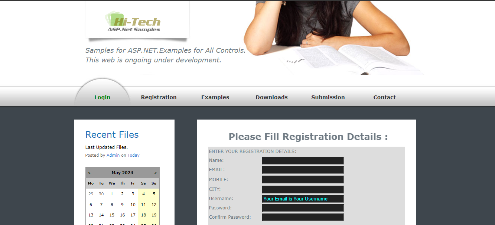
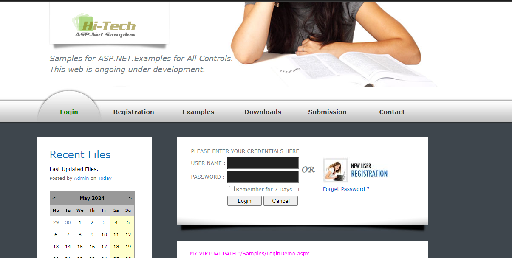
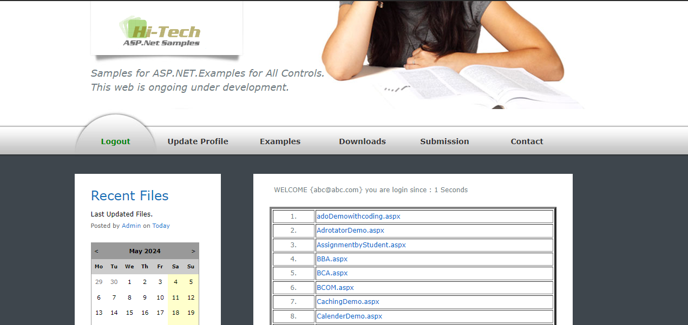
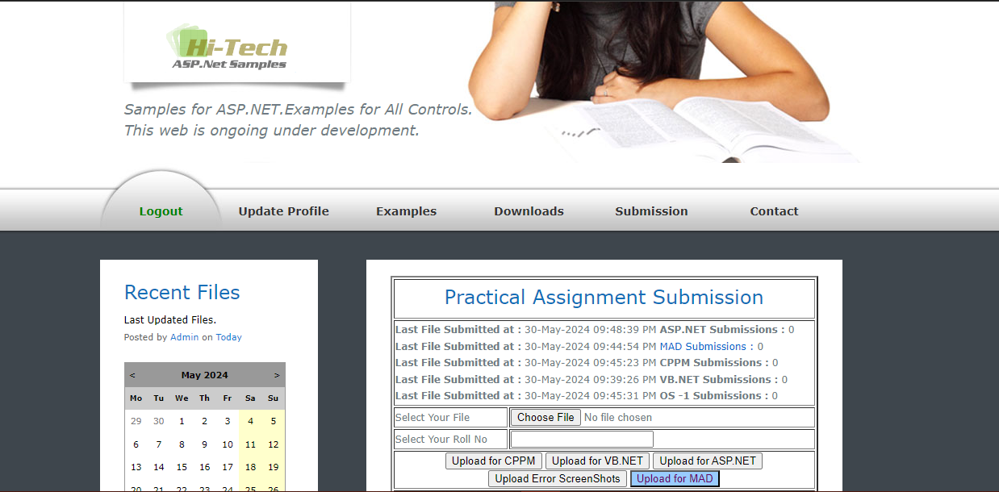
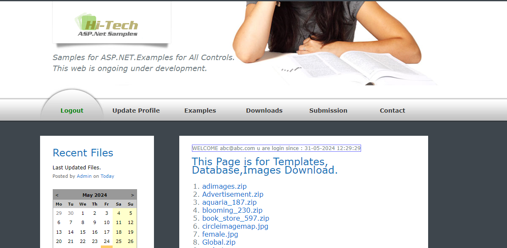

# AspDemoConnect

AspDemoConnect (originally titled **"Hi-Tech ASP.Net Samples"**) is an educational ASP.NET Web Forms lab portal developed using **Visual Basic .NET (`VB.NET`)** and the **.NET Framework**. Built for undergraduate computer science students (such as BCA, BBA, and BCom coursework), it functioned as an interactive intranet portal in a college computer lab environment.

The application allowed students to explore interactive demonstrations of ASP.NET server controls, submit practical assignments across multiple programming subjects, download starter templates and sample databases, and track lab session attendance.

> [!NOTE]
> **Educational & Archival Project**: This is a legacy educational demonstration project built on the classic ASP.NET Web Forms folder-based Web Site model. It is maintained for portfolio, reference, and educational purposes. It is **not** an ASP.NET Core application, does not use Entity Framework migrations or `appsettings.json`, and is not intended for modern production environments without architectural modernization.

---

## Screenshot Gallery

All screenshots are authentic application screenshots.

### Student Registration Page

*Figure 1: Student registration interface (`registration.aspx`) where learners enroll by providing basic contact information and login credentials.*

---

### Student Login Page

*Figure 2: Student authentication portal (`LoginDemo.aspx`) with credential entry, session persistence options, and account assistance links.*

---

### ASP.NET Demonstrations Directory

*Figure 3: Interactive demonstration index (`Welcome.aspx`) showing student session tracking and a categorized catalog of over 70 ASP.NET control samples.*

---

### Practical Assignment Submission

*Figure 4: Multi-subject assignment submission interface (`PracticalAss.aspx` / `Submission.aspx`) supporting uploads for ASP.NET, VB.NET, CPPM, MAD, and OS-1.*

---

### Lab Resources and Downloads

*Figure 5: Lab resource center (`TemplateDownload.aspx`) providing downloadable starter website templates, sample databases, and study assets from `src/Downloads/`.*

---

## Technology Stack

The project relies exclusively on classic .NET Framework technologies and standard web protocols:

| Component | Technology | Details |
| :--- | :--- | :--- |
| **Application Model** | ASP.NET Web Forms | Classic folder-based ASP.NET Web Site architecture |
| **Backend Language** | Visual Basic .NET (`VB.NET`) | Code-behind pages (`.aspx.vb`), modules, and shared classes |
| **Runtime Framework** | Microsoft .NET Framework | Compatible with .NET Framework 2.0, 3.5, and 4.x |
| **Web Server** | IIS Express / IIS | Runs under Visual Studio development server, IIS Express, or full IIS |
| **Frontend UI** | HTML, CSS, JavaScript | Classic layout styling, jQuery (`v1.10.2`), and jQuery UI components |
| **Databases** | SQL Server, Access, MySQL | Microsoft SQL Server / Express (`.mdf`), Microsoft Access (`.mdb`/`.accdb`), MySQL (`MySql.Data.dll`) |
| **Data Access** | ADO.NET | Direct data access using `SqlConnection`, `OleDbConnection`, `MySqlConnection`, `SqlDataAdapter`, and `DataSet` |
| **Configuration** | `web.config` | XML-based configuration managing connection strings, membership profiles, and session state |
| **Development IDE** | Microsoft Visual Studio | Visual Studio 2012 / 2015 / 2017 / 2019 / 2022 (with ASP.NET workload) |

---

## Features & Capabilities

### 1. ASP.NET Control Demonstrations
The repository includes more than 70 standalone demonstration pages designed to illustrate ASP.NET Web Forms features:
- **Standard Controls:** Input handling and postback events using `TextBox`, `Button`, `DropDownList`, `ListBox`, and `Literal`.
- **Rich & Composite Controls:** Demonstrations of `AdRotator` (XML advertisement feeds), `Calendar`, `FileUpload`, `MultiView`, and multi-step `Wizard` controls.
- **Validation Controls:** Client- and server-side validation using `RequiredFieldValidator`, `CompareValidator`, `RegularExpressionValidator`, and `CustomValidator`.
- **Navigation & Layout:** Hierarchical site navigation via `asptutorial.sitemap`, `SiteMapPath`, and `Menu` controls.

### 2. ADO.NET & Multi-Database Connectivity
- **Direct Data Operations:** Examples demonstrating parameterized queries, `SqlCommand`, `SqlDataReader`, `SqlDataAdapter`, and `DataSet` manipulation.
- **Data-Bound Controls:** Extensive demonstrations of `GridView` (custom paging, column templates, inline editing, and master-detail views), `DataList`, `Repeater`, and `FormView`.
- **Multi-Database Support:** Parallel examples connecting to Microsoft SQL Server, Microsoft Access (via OLEDB), and MySQL.

### 3. State Management & Caching
- **State Management Demonstrations:** Hands-on comparisons between client-side state (`Cookies`, `HiddenField`, `QueryString`, `Cross-Page Posting`) and server-side state (`Session`, `Application`, `Profile`).
- **Caching Mechanisms:** Demonstration of page output caching and data caching (`CachingDemo.aspx`).

### 4. Web Services
- Creation and consumption of classic XML Web Services (`.asmx`) for remote procedure calls and service data consumption (`WebServiceDemo.aspx`, `ConsumeWebServiceDemo.aspx`).

### 5. Master Pages, User Controls, and Themes
- **Master Pages:** Reusable page wrappers providing consistent layout across administration and student portals (`AdminMenu.master`, `Moderator.master`).
- **Web User Controls:** Custom modular components (`.ascx`) for date selection and header widgets.
- **Themes & Skins:** Application styling utilizing ASP.NET `App_Themes` and control skin files.

### 6. Student Practical Assignment Submission
A multi-subject coursework submission portal (`PracticalAss.aspx` / `Submission.aspx`):
- Dedicated submission targets for multiple lab courses:
  - **ASP.NET** (Web Application Development)
  - **VB.NET** (Visual Basic .NET Application Development)
  - **CPPM** (C Programming & Programming Methodology)
  - **MAD** (Mobile Application Development)
  - **OS-1** (Operating Systems 1)
- Submission tracking counters displaying total files uploaded per course.
- Dedicated error screenshot upload channel allowing students to submit runtime error captures to instructors.

### 7. Session-Based Attendance Tracking
- **Automated Attendance Logging:** Upon student login and navigation to `Welcome.aspx`, the system inserts an attendance record into the `AttendanceMaster1` database table, recording the student identifier (`student_id`), login timestamp (`loggedInDate` via `getDate()`), and client IP address (`REMOTE_ADDR` / `HTTP_X_FORWARDED_FOR`).
- **Session Duration Display:** Calculates elapsed session time in-memory from `Session("Ltime")` to display active duration in page welcome headers (it does not persist session end times or total duration to the database).
- **Moderator Views:** Dedicated moderator interfaces (`src/Moderator/Attendance.aspx`, `src/Moderator/AttenGrid.aspx`, `src/Admin/allusersEdit.aspx`) allow instructors to review student attendance grids filtered by date and division.

### 8. Lab Resource Downloads
- A centralized download center (`TemplateDownload.aspx`) serving downloadable website starter templates, database backup files, and practical assignment sheets directly from `src/Downloads/`.

---

## Installation & Setup

Because this is a classic **ASP.NET Web Site** project (rather than a compiled Web Application project or modern .NET Core application), it is opened directly as a folder in Visual Studio.

### Prerequisites
- **Operating System:** Windows 10 / 11 or Windows Server.
- **IDE:** [Microsoft Visual Studio](https://visualstudio.microsoft.com/) (2015, 2017, 2019, or 2022) with the **ASP.NET and web development** workload.
- **Server:** IIS Express (installed automatically with Visual Studio) or local IIS.
- **Database (Optional for basic demos):** Microsoft SQL Server Express or LocalDB.

### Setup Instructions

1. **Clone the Repository:**
   ```bash
   git clone https://github.com/contact2hitech/AspDemoConnect.git
   ```

2. **Open the Web Site in Visual Studio:**
   - Launch Visual Studio.
   - Choose **File** > **Open** > **Web Site...** (do *not* use "Open Project/Solution").
   - Browse to the cloned repository directory and select the `src` folder.
   - Click **Open**. Visual Studio will load the folder as a Web Site project.

3. **Review Configuration (`web.config`):**
   - Open `src/web.config`.
   - Inspect the `<connectionStrings>` section. The application includes several preconfigured connection strings for local SQL Server instances (`constrsql`, `constrsql1`, `ConnectionString2018`).
   - If you plan to test database-dependent pages, ensure your local SQL Server instance name matches the connection string (e.g., `Data Source=.\SQLEXPRESS;` or `(localdb)\MSSQLLocalDB`).

4. **Database Setup (For Database-Dependent Demos Only):**
   > [!TIP]
   > Many UI controls, validation, navigation, and client-side state management demos run immediately without an active database.
   - If running data-driven pages, database files (`.mdf`) and SQL scripts are available in `src/App_Data/`:
     - `DEMOSDATA.sql` and `AllDemos2016Upated.sql` contain table definitions and sample seed records.
     - You can execute these scripts against your local SQL Server instance or attach `Database2018.mdf` directly in SQL Server Management Studio (SSMS).

5. **Run the Application:**
   - In Solution Explorer, locate `Welcome.aspx` or `Default.aspx`.
   - Right-click the file and select **Set As Start Page**.
   - Press **Ctrl + F5** (Start Without Debugging) or **F5** to start IIS Express and view the site in your default browser.

---

## Repository Structure

```
AspDemoConnect/
├── screenshots/                       # Authentic application interface captures
│   ├── download_page.png              # Lab resources and downloads view
│   ├── home_page.png                  # Student registration form
│   ├── login_page.png                 # Student authentication screen
│   ├── submission_page.png            # Multi-course assignment upload portal
│   └── tutorial_page.png              # ASP.NET demo index and session banner
├── src/                               # Application root (ASP.NET Web Site)
│   ├── Admin/                         # Administrator management pages
│   │   ├── allusersEdit.aspx          # User record editor
│   │   └── allusersEdit.aspx.vb
│   ├── App_Code/                      # Shared business logic and helper classes
│   │   └── myconnection.vb            # ADO.NET SQL and MySQL helper routines
│   ├── App_Data/                      # Local database files, SQL scripts, and schema dumps
│   │   ├── AllDemos2016Upated.sql     # Database schema and seed script
│   │   ├── ASPNETDB.MDF               # ASP.NET membership database
│   │   ├── Database2018.mdf           # Demo tables database
│   │   ├── DEMOSDATA.sql              # Sample records script
│   │   └── MyWeb.mdb                  # Microsoft Access database
│   ├── App_Themes/                    # ASP.NET skins and themes
│   ├── Bin/                           # Managed assemblies and native interop DLLs
│   │   ├── Interop.Shell32.dll
│   │   └── MySql.Data.dll             # ADO.NET MySQL data provider
│   ├── Downloads/                     # Downloadable templates, starter archives, and assets
│   ├── images/                        # UI graphics, logos, and layout assets
│   ├── jquery/                        # jQuery 1.10.2 and jQuery UI library files
│   ├── Moderator/                     # Moderator portal and attendance reporting
│   │   ├── Attendance.aspx            # Attendance overview
│   │   ├── AttenGrid.aspx             # Detailed attendance data grid
│   │   └── Moderator.master           # Moderator master layout
│   ├── profilephotos/                 # Student profile image storage
│   ├── AdminMenu.master               # Administration master page layout
│   ├── asptutorial.sitemap            # XML site navigation map
│   ├── LoginDemo.aspx                 # User authentication page
│   ├── PracticalAss.aspx              # Practical assignment submission page
│   ├── registration.aspx              # New student registration page
│   ├── TemplateDownload.aspx          # Lab resource and template download page
│   ├── web.config                     # Web application configuration
│   ├── Welcome.aspx                   # Post-login demonstration index
│   └── ... (70+ ASP.NET demo .aspx & .aspx.vb pages)
├── .gitattributes                     # Git line ending configuration
├── LICENSE                            # MIT License
└── README.md                          # Project documentation
```

---

## Project Context & Architectural Notes

- **Historical Context:** Developed as an interactive teaching and lab utility for undergraduate computer science curricula. It served as a centralized classroom hub during lab sessions, eliminating manual file exchanges on thumb drives and providing students with interactive code examples.
- **Architectural Paradigm:** The project employs design patterns common in ASP.NET Web Forms applications of its period: in-process session state (`InProc`), master pages, direct ADO.NET SQL commands within code-behind files, and folder-based Web Site routing.
- **Security Considerations:** Because this system was developed for classroom demonstration on an isolated local network, standard production security measures are absent in the source code. Passwords are handled via plaintext storage or legacy symmetric TripleDES encryption rather than one-way salted password hashing, forms lack anti-CSRF tokens (such as `ViewStateUserKey`), and the application does not enforce HTTPS/TLS. It should be treated strictly as an academic reference artifact, not as a blueprint for production deployment.

---

## License

This project is licensed under the [MIT License](LICENSE).

---

## Contact

- **Author:** [HITESH PATEL (contact2hitech)](https://github.com/contact2hitech)
- **Email:** contact2hitech@gmail.com
- **GitHub Repository:** [https://github.com/contact2hitech/AspDemoConnect](https://github.com/contact2hitech/AspDemoConnect)
